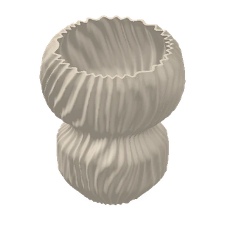
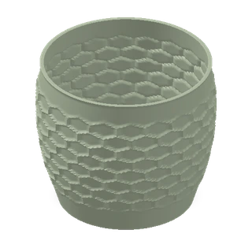
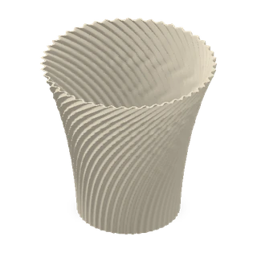

# Form Studio

**A self-hosted, parametric design studio for 3D-printable pots, vases, bowls, lampshades and desk organisers.**

Shape a vessel, layer patterns over its surface, paint where each effect appears, then download an STL or send it to your own Layer Library. Everything runs from your server, with geometry and previews generated in your browser.

<p align="center">
  
  
  
</p>

## What you can make

- **Editable forms:** 24 starting designs, preset or custom silhouette curves, circular/elliptical/polygonal/star cross sections, body twist, lean, rim and foot controls.
- **Layered surfaces:** up to four effects with independent depth, repetition, twist, height range, fade and blend mode. Patterns include coral, braids, ribs, flutes, waves, diamonds, honeycomb and organic relief.
- **Painted and image effects:** paint a mask directly on the model, or turn a grayscale image into surface relief. Images and masks remain part of an editable recipe.
- **Randomise:** generate a vase, plant pot, bowl, lampshade or desk pot; optionally keep the current height and body diameter. Generated designs stay fully editable.
- **Print-oriented details:** hollow walls, closed or open bases, drainage or mounting holes, slots and diamond openings, millimetre dimensions and a configurable build-volume check.
- **Clear previews:** orbit, zoom, section view, print-bed overlay, bright gradient or solid colours, visual layer lines and adjustable preview sharpness. A software renderer provides a fallback when WebGL is unavailable.
- **Local persistence:** saved designs, recoverable trash, browser working drafts, Undo/Redo and portable `.form.json` recipes.
- **Exports:** binary STL at three detail levels and an optional direct connection to Layer Library.

There are no cloud accounts, external fonts or runtime CDN dependencies. Three.js is bundled locally. The server uses Python's standard library and SQLite; it does not need a GPU. Preview performance depends on the computer running the browser.

## Quick start with Docker Compose

Install Docker Engine with Compose v2, then download or clone this repository and open a terminal in its top-level folder:

```sh
docker compose up -d --build
```

Open **[http://localhost:8785](http://localhost:8785)**, or `http://YOUR-SERVER:8785` from another device on your network. Docker builds the application from this checkout and stores designs in a named volume. A published container image is not required.

The default deployment listens on all host interfaces and has **no user login**. Use it on a trusted home network; see [Security](SECURITY.md) before making it reachable from elsewhere. Set `BIND_ADDRESS=127.0.0.1` in `.env` for access only from the Docker host.

Optional settings:

```sh
cp .env.example .env
```

Edit `.env` to change the host port, build volume or container user, then run `docker compose up -d --build` again. The generic default build volume is **256 × 256 × 256 mm**; it is not tied to a printer brand.

See the [installation guide](docs/installation.md) for TrueNAS, bind mounts, permissions, backups and upgrades.

## Run directly with Python

Python 3.12 or newer is sufficient. No Python package installation, Node.js or front-end build is needed to run the app:

```sh
python3 server.py --host 127.0.0.1 --port 8785 --data ./data
```

Open [http://localhost:8785](http://localhost:8785). Use `--host 0.0.0.0` to allow other devices on your trusted LAN. Direct Python launch reads command-line options and the process environment; it does **not** load `.env` automatically.

## A first design

1. Choose **Starting forms**, or click **Randomise** and select an object type.
2. Adjust the form and dimensions. Use the custom profile editor to control the silhouette.
3. Add surface effects. Use their height ranges or **Painted area** controls to limit where they appear.
4. Choose the base, wall thickness and any openings. Check the section view and the measured dimensions.
5. Save the design, then download the STL. Keep a `.form.json` recipe if you want an editable copy outside the server.
6. Open the STL in your slicer to choose material, supports, orientation and print settings.

## Optional: connect Layer Library

Form Studio works independently. Layer Library is a separate self-hosted project for organising printable models; its repository is distributed alongside this one.

In **Settings**, enter the address of your Layer Library, for example `http://your-nas:8777`. Choose **Test connection**, then **Save settings**. **Send to Layer Library** becomes available when an address is saved.

The connection is made by the Form Studio server. The address must resolve to a private LAN, loopback or Tailscale address that the server can reach. The integration requires Layer Library's `trusted_lan` access mode; password-protected installations are not supported by this connector. Leave the address empty to keep the integration disabled.

An uploaded model is added to the **Form Studio** collection when it is new. Where space permits, its editable recipe is stored in the item's notes. Large image/paint recipes can exceed the notes limit: save the design here or download its `.form.json` to retain all settings. See [networking and integration](docs/installation.md#connect-layer-library) for container address examples.

## Scope and practical limits

Form Studio creates parametric vessel-like shells. It does not import arbitrary meshes for editing or replace a general CAD package, slicer or printer controller.

- Wall thickness is a **radial offset**, so it is not constant normal thickness on steep or strongly textured surfaces. Inspect the result in your slicer.
- Build-volume status checks the model's axis-aligned dimensions. It does not account for brims, supports or a different print orientation, and an oversized model can still be exported.
- Preview colours, the gradient and visual layer lines are display settings. STL carries geometry, not those colours or print toolpaths. Wavy geometry also needs ordinary slicing.
- Image maps are converted to 128 × 128 grayscale pixels, and painted masks use 64 × 64 pixels. This keeps recipes compact but limits very fine detail.
- Extreme combinations of lean, depth, profile or perforations can be invalid; the app reports rejected geometry. A generated STL is not a guarantee of a successful or watertight physical print.
- Lampshade output is a model, not an electrically or thermally certified light fitting. Choose suitable hardware, material and clearances for the intended use.

## Development

The application is deliberately small: `server.py` handles persistence and the Layer Library bridge; `static/geometry.js` creates meshes; `static/viewer.js` and `static/software-renderer.js` draw them; `static/app.js` provides the interface. Browser dependencies are already in `static/vendor/`.

Run the backend/configuration tests with Python, and the geometry, rendering and randomisation tests with Node.js 20 or newer:

```sh
python3 -m unittest discover -s tests -p '*_test.py'
npm test
```

`npm test` runs local Node scripts; no `npm install` is needed. A `package.json` is provided for test commands and module configuration, not as a runtime dependency manager.

See [Contributing](CONTRIBUTING.md) for development conventions and [Security](SECURITY.md) for reporting security issues.

## License

Form Studio's application code is available under the [MIT License](LICENSE). Bundled Three.js and OrbitControls retain their upstream MIT notices; see [Third-party notices](THIRD_PARTY_NOTICES.md).
